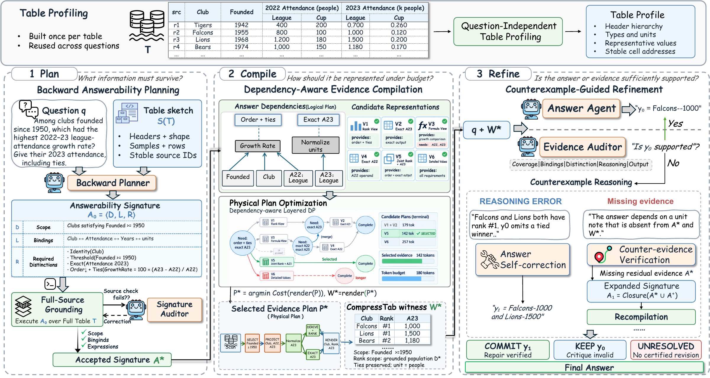

<p align="center">
  
</p>

<p align="center">
  <strong>What must a table preserve?</strong><br>
  Compact evidence. Question-aware representations. Your choice of reader.
</p>

<p align="center">
  <a href="https://github.com/WannaBSteve/CompressTab/actions/workflows/ci.yml"></a>
  
  
  
</p>

<p align="center">
  <a href="#quick-start">Quick start</a> &nbsp;&middot;&nbsp;
  <a href="#python-api">Python API</a> &nbsp;&middot;&nbsp;
  <a href="#framework">Framework</a> &nbsp;&middot;&nbsp;
  <a href="results/README.md">Results</a> &nbsp;&middot;&nbsp;
  <a href="docs/interface.md">Documentation</a>
</p>

## The Idea

A question rarely needs every detail of a table. It does need the right
relationships, distinctions, and context. **CompressTab turns that observation
into a compression engine:** identify what the answer depends on, find a compact
representation, and give the language model evidence it can reason over.

Our vision is to make table compression a reusable layer between structured
data and language models, so context is spent on what the question needs.

| Plan | Compile | Refine |
| --- | --- | --- |
| Work backward from the question to its information requirements. | Combine representations with dependency-aware optimization. | Check the answer and repair reasoning or missing evidence. |

## Quick Start

### Install

```bash
git clone https://github.com/WannaBSteve/CompressTab.git
cd CompressTab
python -m venv .venv
source .venv/bin/activate
python -m pip install -e '.[test,evaluation]'
```

Download a tokenizer for measuring evidence length. This example uses Qwen3-8B:

```bash
mkdir -p models
curl -fL https://huggingface.co/Qwen/Qwen3-8B/resolve/main/tokenizer.json \
  -o models/tokenizer.json
```

### Compile Evidence Without an API Key

Start with the supplied table and Answerability Signature. This runs the
compiler locally, without a model call.

```bash
compresstab compile \
  --input examples/compile.jsonl \
  --output outputs/compiled.jsonl \
  --tokenizer models/tokenizer.json
```

The output contains the compact evidence, its token count, and the selected
representations. You can pass the evidence to your own reader or use the full
question-answering pipeline below.

### Ask a Question

Point CompressTab at an OpenAI-compatible API, including a locally served model:

```bash
export OPENAI_BASE_URL=http://localhost:8000/v1
export OPENAI_API_KEY=your-server-key

compresstab answer \
  --input examples/questions.jsonl \
  --output outputs/answers.jsonl \
  --config configs/qwen.json \
  --tokenizer models/tokenizer.json
```

Set the model ID in the configuration to match your deployment. Planning,
answering, and auditing can use separate models. `compresstab raw` runs direct
answering on the same input. Output paths must be new.

## Python API

```python
from compresstab import (
    CompressTabPipeline,
    ExactTokenCounter,
    JsonLLMClient,
    PipelineConfig,
)

engine = CompressTabPipeline(
    llm=JsonLLMClient(),
    token_counter=ExactTokenCounter("models/tokenizer.json"),
    config=PipelineConfig(model="Qwen3-8B"),
)

answer = engine.answer(
    "Which club had the largest attendance increase? Include ties.",
    {"table": [
        ["Club", "2022", "2023"],
        ["Falcons", 800, 1000],
        ["Lions", 1200, 1500],
        ["Bears", 1000, 1180],
    ]},
)
print(answer)
```

Use `engine.run(...)` when you also need the evidence, signature, audit events,
and API usage. For a supplied signature, use the standalone `CompressTab`
compiler. See the [runnable Python examples](examples/README.md).

## Framework

<p align="center">
  <a href="assets/framework.pdf"></a>
</p>

<p align="center"><a href="assets/framework.pdf">Open the full-resolution framework</a></p>

**1. Backward Answerability Planning.** The planner identifies the scope,
bindings, and distinctions needed to answer the question. Grounding resolves
them against the table; the Signature Auditor checks conflicts.

**2. Dependency-Aware Evidence Compilation.** The compiler builds alternative
representations of source values and derived quantities. Layered dynamic
programming combines compatible choices and selects the shortest complete
rendering in the generated candidate space.

**3. Counterexample-Guided Refinement.** The Answer Agent reasons over the
compiled evidence. The Evidence Auditor checks scope, bindings, interpretation,
reasoning, and output form, then verifies corrections before they are accepted.

The compiler supports exact values, dictionaries, repeated-text factorization,
tie-aware ranks, threshold membership, and derived quantities. Its evidence
target guides operation; complete evidence is retained when it exceeds the
target. [Algorithm details](docs/algorithm.md).

## Evaluation

| Benchmark | Setting | Guide |
| --- | --- | --- |
| WikiTableQuestions | Compositional reasoning over Wikipedia tables | [Data and scoring](docs/data.md) |
| HiTab | Hierarchical tables | [Data and scoring](docs/data.md) |
| TAT-QA | Financial tables and associated text | [Data and scoring](docs/data.md) |
| LongTableBench | Long-context, multi-format table reasoning | [Data and scoring](docs/data.md) |

The [results directory](results/README.md) indexes the prediction files and
their corresponding paper metrics. Evaluation uses the official benchmark
scorers and separately prepared reference answers.

The saved predictions have not been regenerated with the current inference
code. Re-scoring them checks the reported metrics; evaluating the current
pipeline requires a new inference run.

```bash
python scripts/evaluate.py hitab \
  --references data/prepared/hitab/references.jsonl \
  --predictions results/hitab/main/compresstab_deepseek_v3_2.jsonl \
  --official-root data/raw/hitab \
  --output outputs/hitab-metrics.json
```

## Development

```bash
pytest -q
COMPRESSTAB_TEST_TOKENIZER=models/tokenizer.json pytest -q
```

The tests cover evidence preservation, dependency propagation, exact-search
oracles, refinement decisions, official evaluation, and tokenizer-backed costs.

| Entry point | Purpose |
| --- | --- |
| [`pipeline.py`](src/compresstab/pipeline.py) | End-to-end planning, compilation, and refinement |
| [`compress.py`](src/compresstab/compress.py) | Standalone evidence compiler |
| [`codec/evidence.py`](src/compresstab/codec/evidence.py) | Candidate representations and optimization |
| [`agents.py`](src/compresstab/agents.py) | Agent prompts and structured outputs |
| [`docs/interface.md`](docs/interface.md) | Inputs, outputs, and configuration |

Export the agent prompts with `python scripts/export_prompts.py --output
outputs/prompts.json`. See [CONTRIBUTING](CONTRIBUTING.md) for development checks.

## Paper

**What Must a Table Preserve? Answerability-Guided Compression for Table
Question Answering with CompressTab**

Dataset and model assets retain their upstream terms. See [NOTICE](NOTICE.md)
for the current code-licensing status and third-party assets.
